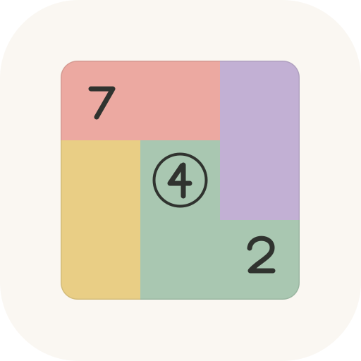
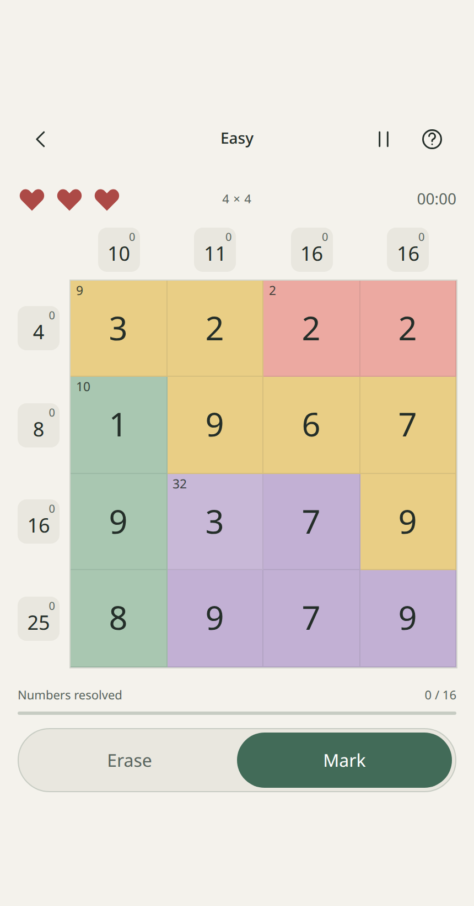

<p align="center">
  
</p>

# Number Sums

**Every number has its place.**

A number puzzle about choosing which values belong in the sums. Match every row, column, and colored region, then resolve the whole board.

**[Play in your browser](https://number-sums-game.pages.dev/)** · [Development guide](docs/DEVELOPMENT.md) · [Verified release](docs/VERIFICATION.md)

<p align="center">
  
</p>

[](https://github.com/Listwas/number-sums/actions/workflows/check.yml)

## Features

- Beginner 3 × 3, Easy 4 × 4, Medium 5 × 5, Hard 6 × 6, or a random difficulty.
- Standard mode with three lives, or Relaxed mode with no life limit.
- Generated puzzles checked for a unique solution using their public clues.
- Current marked sums beside the targets help you track each row and column.
- Automatic saves and statistics by difficulty and mode, including completion times and total playtime.
- Light, dark, and system themes; optional sound effects, volume control, and reduced motion.
- Works on phones, tablets, and desktop, with offline play after the first download.
- No ads, accounts, analytics, or music downloads.

## How to play

1. Each row and column has a target. Colored regions have a small target in their upper-left cell.
2. Choose **Mark** for numbers that contribute to those targets. Choose **Erase** for numbers that do not.
3. A marked number counts toward its row, column, and any colored region it belongs to. Correct choices lock in place.
4. Resolve every number to finish. Targets clear when every cell in their group is resolved, even if the sum was reached earlier.

A mistake costs one life in Standard mode. Relaxed mode has no life limit.

**Keyboard:** **M** chooses Mark, **E** chooses Erase, and **Escape** opens Pause.

The in-game **How to play** includes short interactive examples. **Pause** lets you resume, start over, or return home.

## Install and play offline

Open [the game](https://number-sums-game.pages.dev/) and wait for **Ready offline** before disconnecting.

- **iPhone / iPad:** Open in Safari, then choose Share → Add to Home Screen.
- **Android:** Use your browser's Install app or Add to Home screen option.
- **Desktop:** Play in a tab, or install through a browser that supports web apps.

The fullscreen button requests immersive mode where the browser supports it. iOS may keep the time and battery indicators visible.

Progress and statistics stay in the current browser or installed app. There is no account or cloud sync. Clearing site data removes your saves, and browser tabs may have separate storage from an installed iOS app. When **Refresh app** appears, it saves before applying the update.

## Run locally

Requires **Node.js 22+** and npm.

```sh
git clone https://github.com/Listwas/number-sums.git
cd number-sums
npm ci
npm run dev
```

Open the local address printed by Vite. For a production build:

```sh
npm run build
npm run preview
```

## Development

Built with React, TypeScript, and Vite. This repository builds independently; no other game project or game engine is required.

Puzzle generation runs in a Web Worker with a bounded deadline, cancellation on backgrounding, and recovery from worker failure. The board uses native HTML/CSS/SVG and system fonts. It has no continuous rendering loop.

Sound effects use short synthesized buffers with bounded voices and no playback queue. Audio sleeps after the last effect; hidden apps stop effects and active generation. Saves are coalesced after a paint opportunity and flushed on lifecycle transitions. These measures reduce unnecessary work; physical-device battery life has not been measured.

Start with `npm test` and `npm run build`. The [development guide](docs/DEVELOPMENT.md) covers architecture, browser tests, generation checks, and deployment. [Verification notes](docs/VERIFICATION.md) record the published build and tested limits.

## License

A license for the original project code has not been selected yet. Dependency license notices are in [THIRD_PARTY_NOTICES.md](THIRD_PARTY_NOTICES.md).
